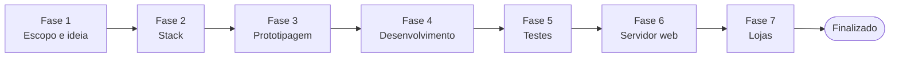

# Playbook das fases

Cada fase tem objetivo, responsáveis, entregáveis e um **gate**: o critério que você aprova para passar à fase seguinte. Para abrir uma fase, use `/iniciar-fase <número>`.

## Fase 1 — Escopo e ideia

- **Objetivo:** definir o jogo: tema e fantasia do jogador, público, plataformas, core loop, meta-loop (prestígio), monetização, diferencial e escopo do MVP.
- **Responsáveis:** `game-designer` (principal), `artista-visual` (moodboard e direção inicial), `especialista-lojas` (impacto da monetização e do público nas políticas), `arquiteto` (viabilidade técnica em alto nível). O Líder conduz e consolida.
- **Ferramentas:** `deep-research` (mercado de idle, concorrentes, tendências e métricas de retenção), `xlsx` (planilha inicial de economia), Canva ou Figma (moodboard).
- **Entregáveis:**
  - `docs/pesquisa/mercado.md`: referências, o que funciona no gênero, oportunidades;
  - `docs/gdd/visao.md`: uma página com a proposta do jogo;
  - `docs/gdd/gdd.md`: core loop, sistemas, progressão, prestígio, monetização, metas de ritmo;
  - `docs/gdd/economia.xlsx` ou `.md`: primeiras fórmulas e tabelas;
  - `docs/gdd/mvp.md`: o que entra e o que fica fora do MVP.
- **Gate:** você aprova a visão, o GDD e o escopo do MVP.

## Fase 2 — Stack

- **Objetivo:** escolher engine/framework do cliente, estratégia para as lojas, back-end, banco, hospedagem, CI/CD, analytics, anúncios e compras.
- **Responsáveis:** `arquiteto` (principal). `dev-frontend`, `dev-backend`, `engenheiro-dados`, `devops` e `especialista-lojas` avaliam em paralelo, cada um do seu ponto de vista.
- **Ferramentas:** `engineering:architecture`, `engineering:system-design`, `context7`.
- **Entregáveis:**
  - um ADR por decisão em `docs/adr/` (engine, back-end, banco, hospedagem, números grandes, save, analytics, anúncios e compras);
  - `docs/arquitetura.md` com diagrama;
  - esqueleto do repositório: estrutura de pastas, lint, um teste de exemplo passando, comando para rodar;
  - CI básico (lint + testes em todo PR);
  - `CLAUDE.md` atualizado: seções Stack, Comandos e a tabela "Onde fica cada coisa".
- **Depois do gate:** instalar os plugins da stack (`docs/ferramentas.md`, seção 4) e os hooks de qualidade (seção 7).
- **Gate:** você aprova os ADRs, o projeto roda localmente, o teste de exemplo passa e o CI está verde.

## Fase 3 — Prototipagem

- **Objetivo:** provar rápido e barato que o core loop é divertido, e definir a direção de arte e de UX.
- **Responsáveis:** `dev-frontend` (protótipo jogável em greybox), `game-designer` (ajuste fino), `qa-balanceamento` (simulação da economia do protótipo), `ui-ux-designer` (wireframes e telas principais), `artista-visual` (guia de estilo e assets provisórios), `animador` (feedback de toque e de números).
- **Ferramentas:** `to-wireframe`, Figma (`figma:figma-generate-design`), `img-to-html`, `openrouter-img`, Canva, `design:design-critique`.
- **Entregáveis:** protótipo jogável, wireframes em `docs/ux/`, guia de estilo em `docs/arte/guia-de-estilo.md`, relatório de simulação com a curva de progressão.
- **Gate:** você joga o protótipo e aprova a diversão, o ritmo e a direção de arte.

## Fase 4 — Desenvolvimento (front + back)

- **Objetivo:** construir o MVP card a card, com `/executar-tarefa` e QA em todo card.
- **Responsáveis:** todas as equipes, coordenadas pelo Líder.
- **Ordem sugerida de épicos:**
  1. módulo de economia puro, com testes de propriedade;
  2. game loop e HUD;
  3. save local, autosave e progresso offline;
  4. geradores, upgrades e marcos;
  5. prestígio;
  6. back-end: contas, cloud save, validação no servidor;
  7. analytics;
  8. monetização (anúncios recompensados e compras);
  9. acabamento: arte final, animações, som;
  10. onboarding e tutorial.
- **Gate:** todos os cards do MVP em Concluído e o jogo completo rodando em ambiente local de homologação.

## Fase 5 — Testes

- **Objetivo:** endurecer o jogo: regressão completa, desempenho, dispositivos reais, simulação de longo prazo, segurança, acessibilidade e um beta fechado.
- **Responsáveis:** Equipe de QA completa. Os devs corrigem os defeitos encontrados.
- **Ferramentas:** `engineering:testing-strategy`, `playwright`, `/security-review`, `design:accessibility-review`.
- **Entregáveis:** `docs/qa/relatorio-geral.md`, defeitos como cards no Kanban, métricas (FPS, memória, tamanho do pacote, tempo de carregamento) contra metas definidas.
- **Gate:** zero defeitos bloqueantes ou críticos e metas de desempenho atingidas.

## Fase 6 — Migração para o servidor web

- **Objetivo:** colocar o jogo e o back-end em produção com segurança.
- **Responsáveis:** `devops` (principal), `engenheiro-dados`, `dev-backend`, `qa-seguranca`.
- **Ferramentas:** `engineering:deploy-checklist`, `engineering:incident-response`, plugins do provedor escolhido (`vercel`, `cloudflare`, `supabase`, `sentry`…).
- **Entregáveis:** ambientes de staging e produção, deploy automatizado, domínio e HTTPS, backups com restauração testada, monitoramento e alertas, `docs/ops/runbook.md`, política de privacidade publicada.
- **Ações humanas:** contratar e pagar hospedagem e domínio, aprovar cada deploy em produção.
- **Gate:** smoke test em produção aprovado, restauração de backup testada e plano de rollback documentado.

## Fase 7 — Criação dos apps nas lojas

- **Objetivo:** publicar na Google Play e na App Store.
- **Responsáveis:** `especialista-lojas` (principal), `devops` (build, assinatura, pipeline), `artista-visual` (ícone, screenshots, banner, vídeo), `ui-ux-designer` (textos da loja), `dev-frontend` (integrações nativas: compras, anúncios, notificações), Equipe de QA (dispositivos reais, teste interno e TestFlight).
- **Ferramentas:** `design:ux-copy`, Canva (`resize-design` para todos os tamanhos), plugins da stack (`expo`, `unity`…).
- **Entregáveis:** builds assinados, fichas das lojas em pt-BR e en, classificação etária, Data Safety e App Privacy, produtos de compra configurados, checklist de envio completo.
- **Ações humanas:** criar e pagar as contas de desenvolvedor (Google Play Console e Apple Developer Program), aceitar contratos, dados fiscais e bancários, guardar as chaves de assinatura, enviar para revisão.
- **Gate:** apps aprovados e publicados.

## Finalizado — pós-lançamento

Monitorar erros (`sentry`) e métricas de retenção (D1, D7, D30), criar eventos, ajustar o balanceamento com feature flags (`growthbook`) e responder a incidentes (`engineering:incident-response`). Novas ideias voltam para o Backlog do Kanban.
