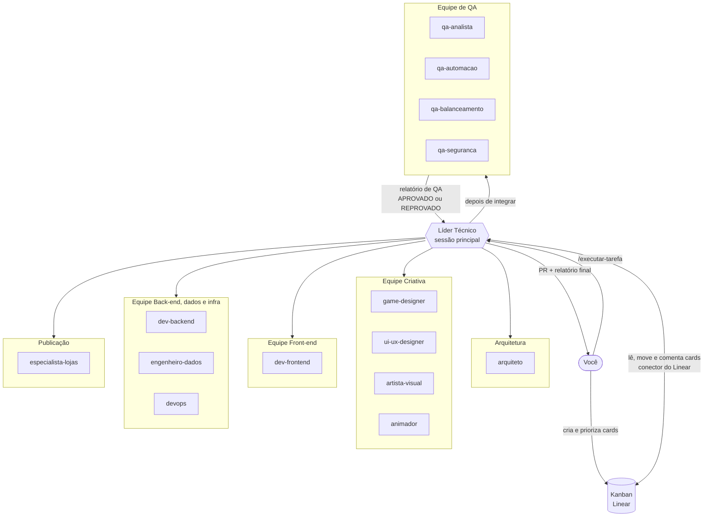
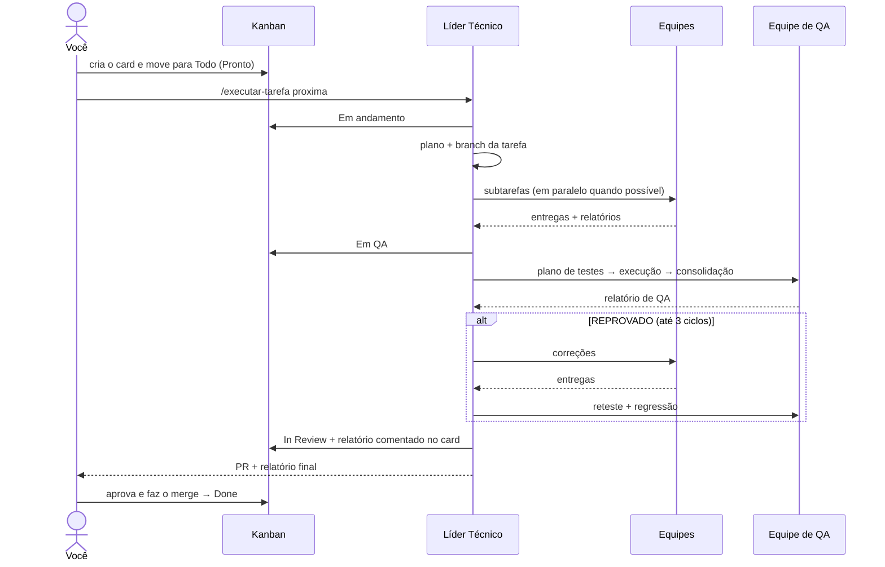

# Como funciona a orquestração de agentes

**Resumo:** a sessão principal do Claude Code é o **Líder Técnico**. Ele lê o Kanban, quebra cada card em subtarefas e aciona **subagentes** especializados (as "equipes"). Cada subagente trabalha com contexto próprio e devolve um relatório. No fim, a **Equipe de QA** testa tudo, o Líder consolida e devolve o resultado para você.

## 1. As peças

| Peça | O que é | Onde fica neste projeto |
|---|---|---|
| **Sessão principal** | O Claude Code com quem você conversa. Aqui ela faz o papel de Líder Técnico. | terminal, app ou IDE |
| **Subagente** | Um especialista com prompt de sistema, ferramentas e modelo próprios. Roda num contexto separado e devolve só o resultado. | `.claude/agents/*.md` |
| **Agent Teams** (experimental) | Várias sessões do Claude Code que conversam entre si e dividem uma lista de tarefas compartilhada. | desligado por padrão (seção 5) |
| **Skill** | Um playbook reutilizável. Pode ser chamado como comando (`/nome`) ou carregado automaticamente quando o assunto aparece. | `.claude/skills/*/SKILL.md` |
| **CLAUDE.md** | Memória do projeto, carregada pela sessão principal e por todos os subagentes. | `CLAUDE.md` |
| **Memória de agente** | Cada agente registra o que aprendeu sobre o projeto e reaproveita nas próximas tarefas. | `.claude/agent-memory/<agente>/` |
| **Hooks** | Regras automáticas que o Claude Code executa em eventos (antes de usar uma ferramenta, quando um subagente termina, quando uma tarefa é concluída…). Podem bloquear uma ação. | `.claude/settings.json` |
| **Conectores (MCP)** | Dão acesso a sistemas externos: Figma, Canva, GitHub, Playwright, Supabase… | conta do claude.ai, `.mcp.json` ou plugins |
| **Plugins** | Pacotes instaláveis com skills, agentes, hooks e conectores prontos. | `/plugin` |

## 2. Como o Líder delega

1. O Líder usa a ferramenta **Agent** informando o tipo de agente (ex.: `dev-backend`) e um prompt.
2. A escolha do agente vem da `description` de cada arquivo em `.claude/agents/`. Por isso as descrições são específicas. Você também pode forçar: "use o qa-balanceamento para…" ou `@agent-qa-balanceamento`.
3. **Cada subagente começa do zero.** Ele não vê a conversa do Líder, só recebe o prompt, o `CLAUDE.md`, a própria memória e as ferramentas permitidas. Por isso o protocolo exige prompts autocontidos.
4. O subagente devolve um relatório. Só esse resumo entra no contexto do Líder, o que mantém a sessão principal enxuta mesmo em tarefas longas.
5. **Paralelismo:** o Líder pode disparar vários subagentes de uma vez (até 20 simultâneos, por padrão). Eles rodam em segundo plano e avisam quando terminam.
6. **Várias instâncias do mesmo agente:** um arquivo de agente é um papel, não uma pessoa. O Líder pode rodar três `dev-frontend` ao mesmo tempo em módulos diferentes, desde que cada instância mexa em arquivos diferentes.
7. **Hierarquia plana:** os membros das equipes têm `disallowedTools: Agent`, ou seja, não criam subagentes próprios (o Claude Code permitiria até 3 níveis). Só o Líder delega. Isso deixa o custo previsível e o relatório em um lugar só.

## 3. Arquitetura deste projeto



## 4. Ciclo de vida de um card



O passo a passo completo que o Líder segue está em `.claude/skills/executar-tarefa/SKILL.md`.

## 5. Subagentes ou Agent Teams?

| | Subagentes (padrão aqui) | Agent Teams (experimental) |
|---|---|---|
| Comunicação | Cada um devolve o resultado ao Líder | Os membros conversam entre si diretamente |
| Coordenação | O Líder controla tudo | Lista de tarefas compartilhada; membros pegam tarefas sozinhos |
| Melhor para | Tarefas focadas em que só o resultado importa | Trabalho que exige discussão: front e back negociando um contrato, investigar um bug com hipóteses concorrentes |
| Custo | Menor (só o resumo volta ao Líder) | Bem maior (cada membro é uma sessão completa do Claude) |
| Limitações | Membros não conversam entre si | Uma equipe por sessão, sem equipes aninhadas, `/resume` não restaura membros em processo |

**Recomendação:** comece com subagentes, como está configurado. Use Agent Teams em cards grandes que cruzam camadas.

Para experimentar Agent Teams, ligue a variável na sua máquina (no shell ou em `.claude/settings.local.json`):

```json
{ "env": { "CLAUDE_CODE_EXPERIMENTAL_AGENT_TEAMS": "1" } }
```

Depois peça ao Líder, por exemplo: *"Crie uma equipe com um membro do tipo dev-backend e outro do tipo dev-frontend para o card #12. Eles devem combinar o contrato da API entre si antes de implementar."* Os membros usam as mesmas definições de `.claude/agents/`. A documentação recomenda começar com 3 a 5 membros. Os hooks `TaskCompleted` e `TeammateIdle` podem barrar a conclusão de uma tarefa até os testes passarem.

## 6. Como dividir as tarefas corretamente

1. **Um card = um resultado verificável.** "Comprar geradores com custo exponencial" é um card. "Fazer o back-end" não é.
2. **Critérios de aceite testáveis**, com números ("Dado… Quando… Então…").
3. **Contrato antes de implementação:** API, formato do save e tabelas de economia são definidos antes de front e back começarem.
4. **Dono único por arquivo** quando há agentes em paralelo.
5. **No máximo 5 ou 6 subtarefas por agente.** Passou disso, o card vira mais de um.
6. **Prompt autocontido:** contexto, objetivo, arquivos permitidos, critérios e formato de retorno.
7. **QA independente:** quem implementa não aprova o próprio trabalho.
8. **Decisões humanas:** você aprova planos grandes, decisões de produto, o merge, deploy em produção e o envio às lojas.

### Quem faz o quê

| Tipo de trabalho | Agente principal | Apoio |
|---|---|---|
| Conceito, regras, números da economia | `game-designer` | `qa-balanceamento` (simula) |
| Escolha de tecnologia, estrutura, contrato de API | `arquiteto` | devs e `devops` (consultados) |
| Fluxo de telas, HUD, textos de interface | `ui-ux-designer` | `artista-visual` |
| Ícones, sprites, fundos, arte de loja | `artista-visual` | `ui-ux-designer` |
| Feedback visual, partículas, transições | `animador` | `dev-frontend` |
| Lógica do jogo no cliente, telas, save local | `dev-frontend` | `game-designer` (regras) |
| API, contas, cloud save, anti-trapaça | `dev-backend` | `engenheiro-dados` |
| Schema, migrações, backups | `engenheiro-dados` | `dev-backend` |
| CI/CD, servidores, deploy, builds | `devops` | `engenheiro-dados` |
| Políticas, ficha da loja, envio | `especialista-lojas` | `artista-visual`, `devops` |
| Plano e relatório de testes | `qa-analista` | — |
| Testes automatizados e exploratórios | `qa-automacao` | — |
| Simulação da economia | `qa-balanceamento` | — |
| Segurança, trapaça, privacidade | `qa-seguranca` | — |

## 7. Custos e desempenho

- Cada subagente consome tokens próprios. Agent Teams consomem bem mais.
- Modelos definidos no campo `model` de cada agente: `opus` para decisões de maior peso (`arquiteto`, `game-designer`, `qa-seguranca`) e `sonnet` para execução. Troque por `haiku` em tarefas simples ou `inherit` para usar o modelo da sessão.
- Paralelize só o que é realmente independente.
- O plugin `session-report` mostra o consumo por sessão e por subagente.

## 8. Comandos do dia a dia

| Comando | O que faz |
|---|---|
| `/iniciar-fase 1` | Abre uma fase do processo: propõe os cards, cria no Kanban e atualiza a fase atual |
| `/nova-tarefa <descrição>` | Transforma um pedido em card bem definido no Kanban |
| `/executar-tarefa proxima` ou `/executar-tarefa 12` | Ciclo completo do card: plano → equipes → QA → PR → relatório |
| `/status` | Board por coluna, bloqueios, o que precisa de você e próximos passos |
| `/agents` | Ver, criar e editar agentes |
| `@agent-<nome> <pedido>` | Chamar um agente diretamente |
| `claude --agent <nome>` | Abrir uma sessão inteira como um agente específico |

## 9. Personalizar os agentes

Cada agente é um arquivo Markdown com cabeçalho YAML seguido do prompt de sistema:

```yaml
---
name: dev-frontend          # identificador (obrigatório)
description: Use para…      # quando o Líder deve acionar (obrigatório)
model: sonnet               # sonnet | opus | haiku | inherit | ID completo
memory: project             # memória em .claude/agent-memory/<nome>/ (versionada)
color: blue                 # cor no terminal
disallowedTools: Agent      # ferramentas removidas (aqui: não cria subagentes)
---
```

Outros campos úteis: `tools` (lista de ferramentas permitidas), `skills` (skills pré-carregadas), `mcpServers` (conectores só daquele agente), `hooks`, `maxTurns`, `effort`, `permissionMode` e `isolation: worktree` (trabalha numa cópia isolada do repositório). Referência completa: https://code.claude.com/docs/en/sub-agents
